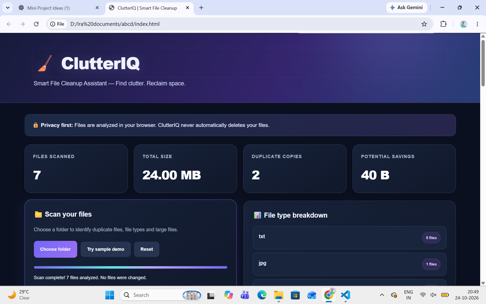
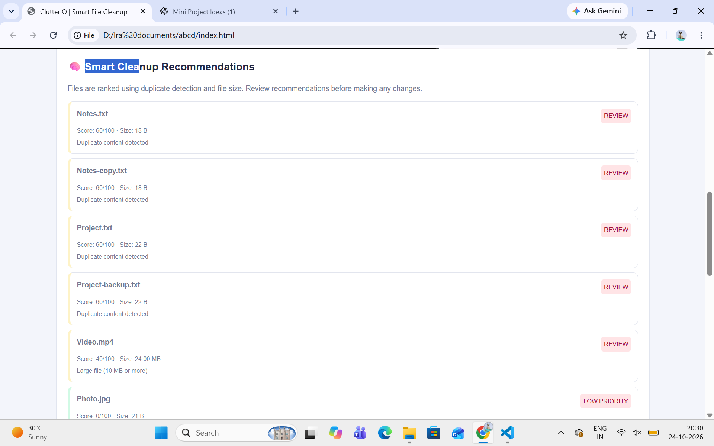

# ClutterIQ — Smart File Cleanup Assistant

**An interactive, browser-based tool for analyzing files and identifying cleanup opportunities.**

## 1. Project Overview

ClutterIQ is a web-based file analysis and cleanup recommendation tool developed to help users understand how their files are distributed and identify opportunities to free up storage space.

Over time, folders can accumulate large files, duplicate copies, and files that users may no longer need. Finding these manually can be time-consuming. ClutterIQ simplifies this process by analyzing a selected folder in the browser and presenting useful statistics, duplicate-file information, and cleanup recommendations through an interactive dashboard.

The application focuses on helping users make informed cleanup decisions rather than automatically deleting files.

## 2. Problem Statement

Users often struggle to understand which files consume the most storage space and whether duplicate copies exist in their folders. Manually inspecting individual files is inconvenient, especially when folders contain many files of different types.

ClutterIQ addresses this problem by providing a visual overview of file storage, identifying potential duplicates, highlighting large files, and assigning recommendation scores to files that may deserve attention.

## 3. Project Objectives

- Analyze files selected by the user through a browser interface.
- Display file statistics and storage-related information in a dashboard.
- Categorize files according to their types.
- Identify potential duplicate files using file-content hashing.
- Detect large files that may contribute significantly to storage usage.
- Generate cleanup recommendations using rule-based scoring.
- Display reasons behind recommendations to support user decisions.
- Estimate potential storage savings from identified opportunities.
- Allow users to export analysis results as a CSV file.
- Provide a simple, interactive interface that does not require a traditional backend server.

## 4. Key Features

### 4.1 Interactive Dashboard

The dashboard presents a summarized view of the selected files and their analysis. It helps users understand the state of their selected folder without manually inspecting every file.

### 4.2 File-Type Analysis

ClutterIQ groups files by their detected file types and displays a breakdown of the selected files. This helps users understand the composition of their folders.

### 4.3 Duplicate File Detection

The application uses SHA-256 hashing to compare file contents and identify files with matching hashes. Files with matching content hashes can be highlighted as potential duplicate copies.

### 4.4 Large File Detection

ClutterIQ identifies files that meet its large-file criteria. This helps users locate files that may be contributing significantly to storage consumption.

### 4.5 Rule-Based Cleanup Recommendations

The application assigns recommendation scores based on implemented rules. Recommendations include explanations so users can understand why a file has been flagged.

The score is a prioritization aid, not a guarantee that a file is unnecessary or safe to delete.

### 4.6 Potential Storage Savings

The dashboard estimates potential storage savings from identified cleanup opportunities. Actual savings depend on which files the user chooses to remove and whether the identified copies or files are genuinely unnecessary.

### 4.7 CSV Export

Users can export analysis results to a CSV file for further review, record keeping, or use in spreadsheet software.

### 4.8 Sample Demonstration

A sample-data mode makes it possible to demonstrate the interface and analysis workflow without selecting a personal folder.

### 4.9 User-Controlled Cleanup

ClutterIQ provides information and recommendations rather than automatically deleting files. Users remain responsible for reviewing the results and deciding what action to take.

## 5. Technology Stack

| Technology | Purpose |
|---|---|
| HTML5 | Defines the structure of the web application. |
| CSS3 | Provides layout, styling, responsive presentation, and visual effects. |
| JavaScript | Implements file analysis, dashboard updates, recommendation logic, and user interactions. |
| Web Crypto API | Provides SHA-256 hashing for duplicate-content comparison where supported. |
| Browser File APIs | Allow the application to work with files selected by the user. |
| CSV | Provides an export format for analysis results. |
| Git | Tracks source-code changes and maintains commit history. |
| GitHub | Hosts the project repository and its version history. |
| Jenkins | Planned DevOps integration for automated validation of project changes. |

## 6. System Architecture

ClutterIQ follows a client-side web application architecture. Its main operations are performed in the user's browser.

**Workflow:**

1. The user opens the website.
2. The user selects a folder or loads the sample demonstration data.
3. The browser provides access to the files selected by the user.
4. JavaScript collects available file information and calculates relevant statistics.
5. The application groups files by type and checks file contents for matching SHA-256 hashes where supported.
6. The recommendation rules assign scores and explanations.
7. The dashboard presents the analysis and potential cleanup opportunities.
8. The user reviews the results and can export the analysis to CSV.

The application does not require a dedicated application server for its basic functionality.

## 7. Working Methodology

### Step 1: File Selection

The user selects a folder through the browser's supported file-selection interface. The browser's permissions and capabilities determine which file information can be accessed.

### Step 2: Data Collection

The application collects the available file metadata, such as file name, file type, and size, for the selected files.

### Step 3: File Categorization

The application organizes files into groups according to their detected types to produce a file-type breakdown.

### Step 4: Duplicate Analysis

The application calculates SHA-256 hashes for file contents where supported. Matching hashes are used to identify potential duplicate copies.

### Step 5: Large File Analysis

Files are checked against the application's large-file criteria to identify files that may require attention.

### Step 6: Recommendation Scoring

Rule-based logic evaluates the available file information and produces recommendation scores with explanatory reasons. The score helps prioritize review; it does not establish that a file is safe to delete.

### Step 7: Dashboard Visualization

The calculated information is displayed in the dashboard, including relevant file statistics, duplicate findings, large-file information, and cleanup recommendations.

### Step 8: Export

Users can export available analysis results in CSV format.

## 8. User Interface Screenshots

Screenshots are included to document the application's interface and demonstrate its main features.

### 8.1 Dashboard



*Figure 1: ClutterIQ dashboard displaying the file-analysis interface and summary information.*

### 8.2 Cleanup Recommendations



*Figure 2: Cleanup recommendation interface showing files identified for further review.*

> Keep the screenshot files in the `screenshots` directory and preserve the filenames referenced above. Replace these images with updated screenshots if the final interface changes.

## 9. Installation and Execution

ClutterIQ is a browser-based application and does not require a conventional installation process for its basic demonstration.

### Requirements

- A modern web browser.
- The project source file, `index.html`.
- A local copy of the project repository.

### Run Locally

1. Download or clone the project repository.
2. Open the project folder.
3. Open `index.html` in a supported web browser.
4. Grant the browser any file-selection permission it requests.
5. Select a folder or use the sample demonstration mode.
6. Review the displayed analysis and recommendations.

If a browser restricts a feature when the file is opened directly, run the project using a simple local development server and try again.

## 10. Project Structure

The project is organized as follows:

```text
ClutterIq/
├── index.html
├── README.md
└── screenshots/
    ├── dashboard.png
    └── recommendations.png
```

- `index.html`: Contains the website's HTML, CSS, and JavaScript implementation.
- `README.md`: Documents the project, setup, features, workflow, and development process.
- `screenshots/`: Contains visual evidence of the working application.

This structure should be updated if additional source files or configuration files are introduced.

## 11. Git and GitHub Version Control

Git is used to track changes to the ClutterIQ source code. GitHub hosts the repository so the project and its development history can be reviewed.

**Repository:** https://github.com/IraKulkarni24/ClutterIQ

### Initial Version Control Workflow

1. Initialize or use the local Git repository.
2. Stage the intended project files.
3. Create a commit with a meaningful message.
4. Connect the local repository to GitHub.
5. Push the `main` branch to GitHub.
6. Verify that the source code appears in the online repository.

### Planned Commit History

The following table will be completed with actual commit hashes and dates after each change has been implemented and committed.

| No. | Planned change | Commit message |
|---|---|---|
| 1 | Initial website implementation | `Add initial ClutterIQ website` |
| 2 | Project documentation and screenshots | `Add project documentation` |
| 3 | First meaningful website enhancement | To be recorded after implementation |
| 4 | Second meaningful website enhancement | To be recorded after implementation |
| 5 | Third meaningful website enhancement | To be recorded after implementation |

Only completed changes should be listed as actual commits. The final report should include real commit identifiers and screenshots of the repository history.

## 12. DevOps Integration — Jenkins

Jenkins is planned as the DevOps tool for this project. The intended integration is to automate a basic validation workflow for the website whenever changes are submitted to the configured pipeline.

The pipeline will be documented after the actual Jenkins setup and execution are completed.

The final integration record should include:

- Jenkins installation and configuration details.
- The project or repository configuration used.
- The pipeline configuration or validation script.
- The steps required to run the pipeline.
- Screenshots showing the configured job and its execution result.
- Any errors encountered and how they were resolved.

**Status:** Integration steps and execution evidence are to be added after Jenkins is configured and tested. No successful Jenkins run is claimed at this stage.

## 13. Privacy and Safety Considerations

- The user selects the files to analyze.
- File access is subject to browser capabilities and permissions.
- Cleanup recommendations are advisory.
- The application does not automatically delete files.
- Users should review recommendations before taking action.
- The application should not be assumed to upload files to a server; its implemented data-handling behavior should be verified before making broader privacy claims.

## 14. Limitations

- File access depends on browser support and user permissions.
- Duplicate identification depends on successful content hashing and the files available for analysis.
- Rule-based recommendations are heuristic and may not reflect the user's personal needs.
- Potential storage savings are estimates rather than guaranteed results.
- The current application is designed for browser-based analysis rather than unrestricted access to the entire computer.
- Jenkins automation and its validation coverage depend on the final pipeline implementation.

## 15. Future Enhancements

Possible future improvements include:

- More advanced filtering and sorting of analysis results.
- Additional recommendation rules and configurable thresholds.
- Improved reporting and export options.
- More comprehensive automated validation.
- A Jenkins pipeline integrated with repository updates.
- Additional usability and accessibility improvements.

These are potential enhancements and should not be considered implemented until they are completed and tested.

## 16. Conclusion

ClutterIQ demonstrates how HTML, CSS, and JavaScript can be used to create an interactive file-analysis tool that helps users identify duplicate files, review large files, understand file-type distributions, and prioritize possible cleanup opportunities.

The project also provides a practical foundation for demonstrating software version control with Git and GitHub. The planned Jenkins integration will extend the project into a basic DevOps workflow by documenting and automating validation of project changes.

The final submission will include the completed website, its source code, a meaningful commit history, actual DevOps integration evidence, and screenshots documenting the work.

---

**Project:** ClutterIQ — Smart File Cleanup Assistant  
**Repository:** https://github.com/IraKulkarni24/ClutterIQ  
**Project type:** Third-year engineering mini-project  
**Subject:** DevOps and Kubernetes — ISE–2
